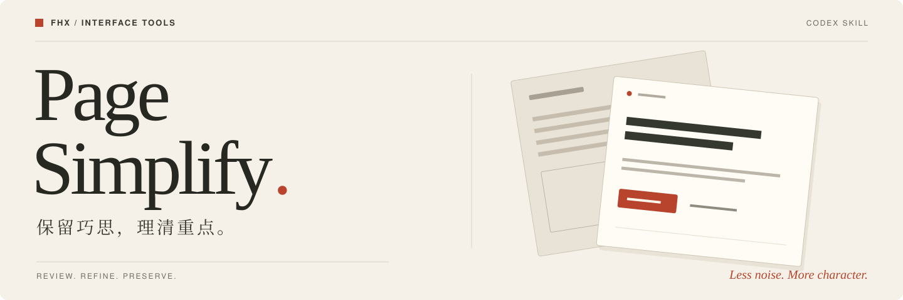

<p align="center">
  
</p>

<p align="center">
  <strong>给页面做减法，让设计更清楚。</strong><br>
  一份中文 Codex Skill，整理冗余文案、重复模块和操作路径，校准视觉层级与对齐。
</p>

<p align="center">
  <a href="#案例">查看案例</a> ·
  <a href="#安装">安装</a> ·
  <a href="#怎么用">开始使用</a> ·
  <a href="SKILL.md">完整规则</a>
</p>

---

## 案例

同一个「纸间」落地页，同一套内容与视觉主题。

<table>
  <tr>
    <th width="50%">精简前 · 重点被反复表达</th>
    <th width="50%">精简后 · 内容与行动更集中</th>
  </tr>
  <tr>
    <td valign="top"></td>
    <td valign="top"></td>
  </tr>
  <tr>
    <td valign="top">小字、标签和收尾模块反复表达同一主题；创建项目需要经过欢迎弹窗。</td>
    <td valign="top">保留纸张插画与暖色氛围，合并重复表达，统一对齐，直接进入创建表单。</td>
  </tr>
</table>

[完整案例与验证记录 →](examples/landing-page-before-after.md)

<details>
<summary><strong>展开移动端对比</strong></summary>

<table>
  <tr><th width="50%">精简前</th><th width="50%">精简后</th></tr>
  <tr>
    <td valign="top"></td>
    <td valign="top"></td>
  </tr>
</table>

</details>

下载仓库后，用浏览器打开 [原始页面](examples/before.html) 和 [精简后页面](examples/after.html)，即可体验交互。这是原创演示案例，判断过程和测试范围见案例记录。

## 它会整理什么

| 页面里的问题 | 处理方向 |
| :--- | :--- |
| 小字、口号和标签太多，重点难找 | 删除重复表达，让标题与必要信息更清楚 |
| 模块重复、容器叠加、操作绕行 | 合并同类内容，减少无独立作用的步骤 |
| 字号、间距、图标和色彩失衡 | 校准对齐与视觉层级，减弱抢眼的装饰 |
| 已有明确风格，还需要精修 | 保留品牌气质、构图节奏和交互隐喻 |

**先判断价值，再决定取舍。** 有价值但太突出的元素，优先减弱；用途不明的既有设计默认保留。必要信息、业务功能、真实能力与无障碍使用始终受到保护。

## 安装

已安装 [GitHub CLI](https://cli.github.com/) 时，在终端运行：

```bash
mkdir -p "${CODEX_HOME:-$HOME/.codex}/skills"
gh repo clone haidarkhanuk3344-collab/page-simplify "${CODEX_HOME:-$HOME/.codex}/skills/page-simplify"
```

重新打开 Codex 或开始新会话，然后用 `$page-simplify` 调用。目标文件夹已存在时，请先检查已有版本，避免覆盖本地修改。

<details>
<summary>手动安装与目录结构</summary>

1. 点击仓库右上角 **Code → Download ZIP**，解压后将文件夹命名为 `page-simplify`。
2. 将文件夹放入 `~/.codex/skills/`；如设置了 `CODEX_HOME`，放入该目录下的 `skills/`。
3. 确认 `SKILL.md` 位于 `page-simplify` 根目录，重新打开 Codex 或开始新会话。

```text
page-simplify/
├── SKILL.md          核心规则
├── README.md         安装与使用
├── LICENSE           MIT 许可
├── PUBLISHING.md      分发说明
├── assets/           README 封面
├── examples/         前后对照、HTML 与截图
└── references/       可选审查表模板
```

</details>

## 怎么用

### 先审查，再决定改什么

```text
用 $page-simplify 审查这个页面，先列出值得保留的设计，再给出可定位的精简建议，暂时不要改代码。
```

### 直接精简已有页面

```text
用 $page-simplify 精简这个页面，保留现有品牌风格与功能，整理重复文案和模块，优先减弱抢眼的装饰，并检查窄屏布局。
```

### 只做视觉校准

```text
按 $page-simplify 校准这个界面的对齐、字号、间距和动效，让主次更清楚，保留有意的不对称和视觉记忆点。
```

## 继续了解

| 资源 | 内容 |
| :--- | :--- |
| [核心规则](SKILL.md) | 判断依据、精简规则、执行与验证流程 |
| [完整案例](examples/landing-page-before-after.md) | 每一项取舍的理由、桌面与窄屏验证记录 |
| [审查模板](references/review-table-template.md) | 需要逐项评审时使用的可选表格 |
| [分发说明](PUBLISHING.md) | 来源、发布检查与介绍文案 |

实际审查和修改依赖 Codex 能访问的页面、源码及工具；仅有截图时，只能评估可见内容。最终效果需要结合实际页面与使用情境验收。

---

<p align="center">
  <strong>保留巧思，理清重点。</strong><br>
  FHX · <a href="LICENSE">MIT License</a>
</p>
